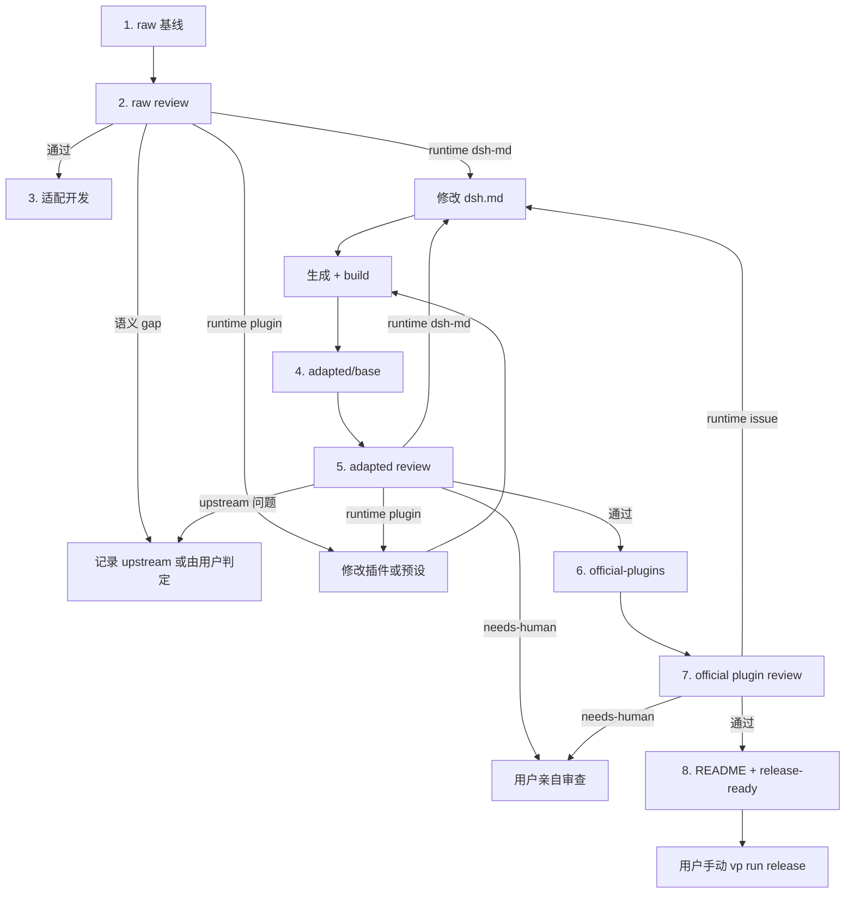

# Playground 验证闭环

本文件给出 `playground/AGENTS.md` 的完整阶段、命令和审批门。所有命令在仓库根执行，Linux 是唯一官方支持平台。所有 `prepare` 命令都省略 `--workers`；默认由 `capacity.ts` 按当前机器的核数、空闲内存和上限计算最大值，只有明确需要限制并发时才写 `--workers N`。

`prepare → bootstrap → run-batch → collect` 必须作为同一个长期存活的 background job 串行执行，不能拆成独立 bash 调用；shell 要活到 collect 结束。不要用 `&`、`nohup` 或 `tee`。如果 `vp run` wrapper 被 SIGTERM，改用 `vpx playground/scripts/*.ts` 直接调用。

## 闭环总览



每次 review 后不是都要改代码。先按 finding 的 `decision` 分流：

- `accept`：只记录点评，不改适配。
- `dsh-md`：改目标适配文档，重新生成并跑受影响 phase。
- `plugin`：改插件、工具或预设，build 后跑受影响 case。
- `skip`：在 `dsh.md` 写跳过或替代规则，不写插件补偿。
- `ignore-environment`：只记录环境限制，不进入移植 backlog。
- `upstream`：记录为上游技能问题，不在本仓修。
- `needs-human`：停下来交给用户，不允许自动选一个 decision。

## 阶段交接

| 阶段 | 进入条件 | 产物 | 出口 |
| --- | --- | --- | --- |
| 1. raw 基线 | 无当前 raw 记录 | `reports/runs/raw-base/summary.md`、`reports/scenarios/**/raw-base/` | raw review |
| 2. raw review | raw 记录完整 | `reviews/scenarios/**/<phase>-<environment>.json`（含 runtime） | 通过则进适配开发；有 gap 回到对应 decision |
| 3. 适配开发 | review 给出 `dsh-md` 或 `plugin` | 更新 `dsh.md` 或插件、生成树、build | adapted/base |
| 4. adapted/base | 新 build 完成 | `reports/runs/adapted-base/summary.md`、`reports/scenarios/**/comparison.md` | adapted review |
| 5. adapted review | adapted 记录完整 | `reports/runs/adapted-base/runtime-review.md`、`reviews/runtime-review/adapted-base.json`、`reports/approvals/adapted-base.md` | `Runtime gate: clear` 后进 official-plugins；否则回到第 3 阶段 |
| 6. official-plugins | adapted/base 通过 | `reports/runs/adapted-<plugin>/summary.md`、`reports/scenarios/official-plugins/**/comparison.md` | official plugin review |
| 7. official plugin review | 各插件记录完整 | `reports/approvals/official-plugins.md` | `Runtime gate: clear` 后进 README/release |
| 8. README + release-ready | 前两轮审批通过 | README/兼容表、`vp run ci` 通过 | 用户手动 `vp run release` |

一个会话只接一个阶段，入口条件和出口产物以这张表为准。不要把 review 的下一步留成“看起来没问题”，必须落到某个 decision。

## 进度

`run-batch` 在 `playground/.workers/<phase>/<environment>/progress.json` 写入当前轮次、已完成数、运行中的场景和失败列表，并在终端打印该路径。查看：

```sh
vp run playground:status -- --phase raw --environment base
```

`prepare --reset` 会清空该 phase 的 worker 目录，因此旧进度不会保留；重新 prepare 后从新一轮开始。

## 运行时审查

review sidecar 可以带 `runtime` 字段，记录每个运行时差异的 kind、severity、decision、observation、action 和 evidence。`review --apply` 会把它写入 `RunRecord.runtimeReview`，`collect` 会生成 `reports/runs/<phase>-<environment>/runtime-review.md`，只保留 finding 并合并重复项；summary、comparison 和 approval 仍区分 semantic 与 runtime。

无法可靠分类的 finding 必须写成 `kind: "unclear"`、`decision: "needs-human"`、`status: "needs-review"`，交给用户审查；`needs-review` 和未填写的 runtime review 都不能当作 clean。

`collect` 同时会在 `reviews/runtime-review/<phase>-<environment>.json` 生成点评骨架，每条 finding 有稳定 id。只写点评时编辑这个 JSON 的 `decision` 和 `comment`，再重新 collect；点评列会显示在 `runtime-review.md`。approval 的 Runtime gate 会把 `pending`、`reject` 和 `needs-human` 视为未完成；只有 `accept` 才放行。如果要改 finding 本身，改对应 scenario 的 `reviews/scenarios/<group>/<scenario>/<phase>-<environment>.json`，执行 `review --apply` 后再 collect。

## 1. raw 基线

```sh
vp run playground:raw-generate
vp run playground:prepare -- --phase raw --environment base --reset
vp run playground:bootstrap -- --phase raw --environment base --all
vp run playground:run-batch -- --phase raw --environment base --groups skills
vp run playground:run-batch -- --phase raw --environment base --groups playbooks
vp run playground:collect -- --phase raw --environment base
vp run playground:review
vp run playground:review -- --apply
```

产物：`reports/runs/raw-base/summary.md`、`reports/scenarios/skills/*/raw-base/`、`reports/scenarios/playbooks/*/raw-base/`、`reviews/scenarios/`。

Gate：raw 场景 sidecar 通过；runtime review 没有 `needs-review` 或 `unreviewed`；`playground/raw/dsh.md` 与 `dsh.zh.md` 逐行确认。

## 2. 适配开发

维护：

- `playground/raw/dsh.md`、`dsh.zh.md`：raw 基准答案。
- `port/dsh.md`、`dsh.zh.md`：最终随包答案。
- `src/`、`cordis.patch.yml`：插件实现与装配。
- `playground/raw/dsh-evidence.md`：判定依据。

生成并构建：

```sh
vp run playground:raw-generate
vp run generate
vp run generate:check
vp run build
```

Gate：`dsh.md` 逐行审批；`generate:check` 通过。

## 3. adapted/base

```sh
vp run playground:prepare -- --phase adapted --environment base --reset
vp run playground:run-batch -- --phase adapted --environment base --groups skills
vp run playground:run-batch -- --phase adapted --environment base --groups playbooks
vp run playground:collect -- --phase adapted --environment base
vp run playground:review
vp run playground:review -- --apply
```

产物：`reports/runs/adapted-base/summary.md`、`reports/scenarios/skills/*/comparison.md`、`reports/scenarios/playbooks/*/comparison.md`、`reports/approvals/adapted-base.md`。

Gate：`reports/approvals/adapted-base.md` 的 Runtime gate 为 `clear` 且 semantic 通过；`needs-review` 或 `unreviewed` 必须人工审查。不通过回第 2 阶段。

## 4. official-plugins

对 `forge`、`session-search`、`browser-use`、`terminal`、`agent-team` 逐个运行：

```sh
# adapted/base official baseline; workers from stage 3 can be reused
vp run playground:prepare -- --phase adapted --environment base --reuse
vp run playground:run-batch -- --phase adapted --environment base --groups official-plugins
# each plugin environment
vp run playground:prepare -- --phase adapted --environment <plugin> --reset
vp run playground:run-batch -- --phase adapted --environment <plugin> --groups official-plugins
vp run playground:collect -- --phase adapted --environment <plugin>
```

同一个 official-plugin 场景必须有 `adapted/base` 和 `adapted/<plugin>` 记录；raw/base 不作为这一组的必选基线。产物：`reports/scenarios/official-plugins/<plugin>/comparison.md`、`reports/runs/adapted-<plugin>/summary.md`、`reports/approvals/official-plugins.md`。

Gate：`reports/approvals/official-plugins.md` 的 Runtime gate 为 `clear` 且插件矩阵审批通过。插件限制写进 `dsh.md` 与根 README，不另设冲突类型。

## 5. README 与发版

更新根 `README.md`、`README.zh.md`、`port/AGENTS.md`、`docs/architecture.md`，然后：

```sh
vp run compatibility:check
vp run ci
```

agent 停在 release-ready。`vp run release` 由用户手动执行，bumpp 负责更新版本并提交推送。

## 上游 DSH 或 pstack 更新

1. 更新 upstream pin 与 `playground/baseline.json` 的兼容键。
2. 从第 1 阶段重跑 raw。
3. 重新逐行确认 `playground/raw/dsh.md` 和 `port/dsh.md`，同步中文版。
4. 重新生成两棵树并 build。
5. 重跑 adapted/base 与 official-plugins，更新报告和审批。
6. 更新 README/兼容表，准备 release-ready。
